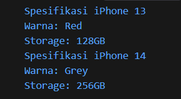
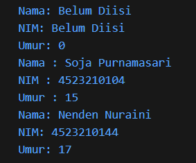
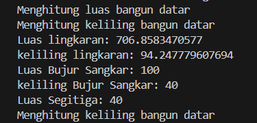
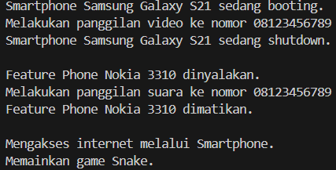
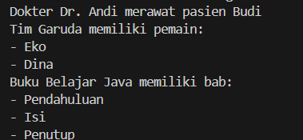
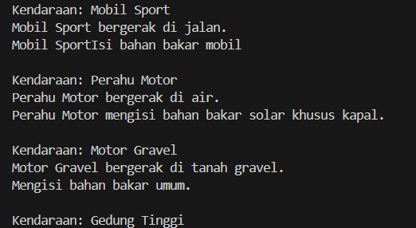

# PEMROGRAMAN BERORIENTASI OBJEK

## Biodata

| **Keterangan** | **Isi** |
|---|---|
| Nama | **Muhammad Syamil** |
| NIM | **4525210130** |
| Program Studi | **Teknik Informatika** |
| Kelas | **A** |
| Mata Kuliah | Pemrograman Berorientasi Objek |
| Dosen Pengampu | **Adi Wahyu Pribadi, S.Si., M.Kom** |
| Semester | **3 (Ganjil)** |

## Teknologi yang Digunakan

Tugas dibuat menggunakan  bahasa pemrograman berikut:

- **PHP** dengan PHP interpreter.

Visual Studio Code digunakan sebagai IDE dengan extension Java Red Hat,
PHP Intelephense, Prettier, dan Error Lens.

## Materi Pembelajaran

Repository ini berisi penerapan konsep pemrograman berorientasi objek
tugas 01 sampai tugas 06:

1. Class dan Object
2. Encapsulation dan Constructor
3. Inheritance dan Method Overriding
4. Polimorfisme
5. Asosiasi, Agregasi, dan Komposisi
6. Abstract Class dan Interface

Setiap tugas dibuat dalam versi Java dan PHP. Penjelasan implementasi yang
lebih rinci tersedia pada README di masing-masing folder tugas.

---

## Tugas 01 - Class dan Object

### Screenshot Hasil Run

#### Hasil Run PHP

---

## Tugas 02 - Encapsulation dan Constructor

### Screenshot Hasil Run

#### Hasil Run PHP

---

## Tugas 03 - Inheritance dan Method Overriding

### Screenshot Hasil Run

#### Hasil Run PHP

---

## Tugas 04 - Inheritance dan Polimorfisme

### Screenshot Hasil Run

#### Hasil Run PHP

---

## Tugas 05 - Asosiasi, Agregasi, dan Komposisi

### Screenshot Hasil Run

#### Hasil Run PHP

---

## Tugas 06 - Abstract Class dan Interface

### Screenshot Hasil Run

#### Hasil Run PHP

